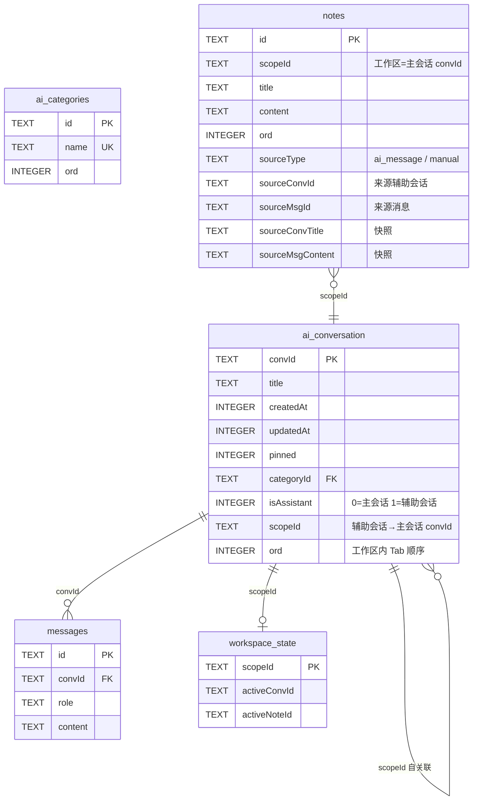
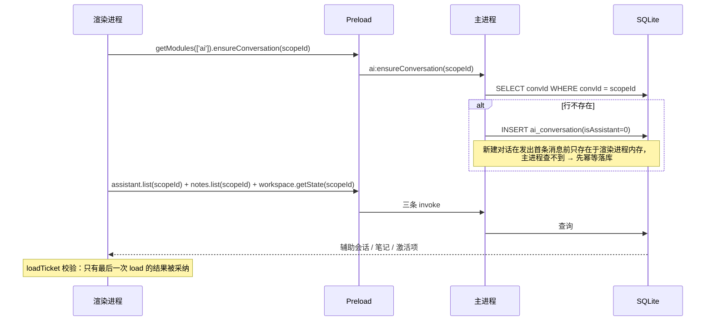
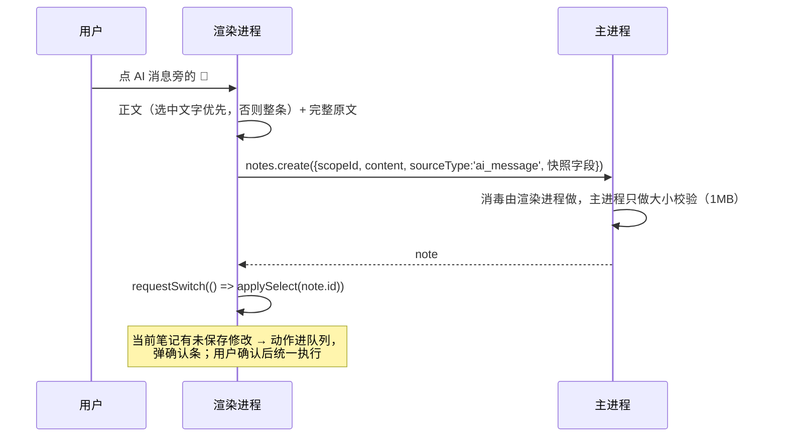
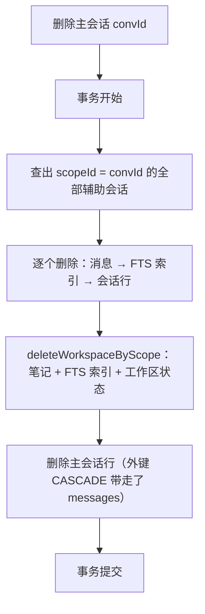

# AI 模块设计（会话体系 + 辅助面板）

> 面向架构面试的模块文档。需求规格见 [ASSISTANT_PANEL.md](ASSISTANT_PANEL.md)，项目整体架构见 [ARCHITECTURE.md](ARCHITECTURE.md)。

---

## 目的

在主会话旁边挂一个"第二个大脑" —— 同一个主会话工作区里同时跑另一个 AI（辅助会话）和一份富文本笔记（可从任意一条 AI 消息摘录而来），两者互不干扰，且随主会话一起销毁。

模块边界：**会话体系（ai）+ 辅助面板（assistant / notes / workspace / search）**。

---

## 接口

### 1. 模块边界：谁拥有哪张表

一个模块只拥有自己的表，写别的表的路径必须走对方的 API —— 这是级联删除不出错的根本原因。

| 表 | 归属模块 | 为什么是它 |
|----|---------|-----------|
| `ai_conversation` | `ai` | 主会话和辅助会话共用一张表，用 `isAssistant` 区分，用 `scopeId` 表达归属 |
| `messages` | `ai` | 消息永远挂在会话下，随会话删除 |
| `ai_categories` | `ai` | 目录是主会话的组织方式 |
| `notes` | `notes` | 笔记属于**工作区**，不属于产生它的辅助会话 |
| `notes_fts` | `notes` | 笔记全文索引，由 notes 模块自己同步 |
| `workspace_state` | `workspace` | 每个工作区一份"当前激活项"状态 |
| `messages_fts` | `ai` | 消息全文索引 |

关键约定：**辅助会话和主会话是同一种东西**（都是会话），区别只在两个字段：

- `isAssistant = 1` → 这是辅助会话
- `scopeId = <主会话 convId>` → 它属于哪个工作区

所以辅助会话天然复用了主会话的全部能力：流式输出、标题自动改名、目录、消息持久化，不需要为它写第二套。

### 2. 核心概念：工作区（scope）

```
工作区 scopeId = 主会话 convId
├── 辅助会话 N 个（ai_conversation.isAssistant = 1, scopeId = 主会话）
├── 笔记 N 条   （notes.scopeId = 主会话）
└── 激活状态     （workspace_state.scopeId = 主会话）
```

**一个主会话 = 一个工作区**。切换主会话 = 切换工作区，面板里的辅助会话和笔记整体换掉。

为什么用主会话的 `convId` 当 scopeId，而不是另起一套 id：

1. 不需要额外的工作区注册表 —— 主会话本身就是工作区的唯一标识；
2. 级联删除有了天然入口 —— 主会话被删，scopeId 跟着消失，按 scopeId 清理即可；
3. 渲染进程不用维护"工作区 ↔ 主会话"的映射表，少一份可能不同步的状态。

### 3. 数据模型



**快照字段为什么存在**：摘录笔记时把来源会话标题和消息原文**复制**进 `sourceConvTitle` / `sourceMsgContent`。辅助会话是可以被单独删掉的 —— 如果笔记只存 `sourceConvId`，来源一删，笔记就成了"来自一个不存在的会话的孤儿"。存快照后，即使来源消失，笔记仍然可读、可追溯，代价是几 KB 冗余，对笔记这种低频写、长生命周期的数据很划算。

### 4. IPC 契约

四个新模块，全部走 `invoke`（请求-响应），渲染端统一用 `window.bridge.getModules(['xxx']).xxx` 取用。

| 模块 | Channel | 方法 | 入参校验 |
|-----|---------|------|---------|
| `assistant` | `assistant:create` | `create(scopeId)` | scopeId 必须是**已落库的主会话**，否则返回 `null` |
| | `assistant:list` | `list(scopeId)` | id 格式校验 |
| | `assistant:getMessages` | `getMessages(convId)` | convId 必须是辅助会话 |
| | `assistant:rename` | `rename(convId, title)` | convId 必须是辅助会话 |
| | `assistant:deleteSession` | `deleteSession(convId)` | convId 必须是辅助会话 |
| | `assistant:reorder` | `reorder(scopeId, ids)` | 只改属于该 scope 的会话 |
| `notes` | `notes:create` | `create(input)` | scopeId 必须是已落库主会话，否则抛错 |
| | `notes:list` / `get` / `update` / `delete` / `reorder` | | id 格式校验；reorder 只改本 scope |
| `workspace` | `workspace:getState` / `setActive` / `deleteState` | | id 格式校验 |
| `search` | `search:query` | `query(keyword)` | 关键词 trim，空串返回空 |

**第一道边界：ID 格式**（`electron/shared/ids.ts`）

```ts
const SAFE_ID = /^[A-Za-z0-9_-]{1,64}$/
```

ID 全部由主进程生成，字符集固定。IPC 入口只接受这一套字符 —— SQL 走预编译语句，参数化本身已经挡住注入，但 ID 格式校验挡的是"非法业务语义"（比如把 scopeId 传成一句 SQL 片段）。

**第二道边界：归属校验**（各 handler 里的 `isMainConversation` / `isAssistantConversation`）

光格式合法不够，还要看**归属对不对**：

- 建笔记 / 建辅助会话 → scopeId 必须是一个真实存在的主会话；
- 读消息 / 改名 / 删辅助会话 → convId 必须确实是辅助会话；
- 主会话要走带工作区级联的删除路径，不能用辅助会话的删除通道绕过级联。

这道防线挡住的是一类具体的越权：渲染进程如果传了别的工作区的 scopeId，笔记就会挂到别人的工作区里，对方打开面板就能看到 —— 工作区隔离不能只靠渲染端自觉。

---

## 关键流程

### 5.1 打开面板 → 工作区就绪



**为什么需要 `ensureConversation`**：这是真实 bug 修出来的。侧边栏新建的对话在发出第一条消息之前只活在渲染进程内存里（`local-` 前缀 id），主进程没有这一行。辅助面板拿主会话当工作区，直接查就查不到 → 辅助会话和笔记全都无处归属 → 面板打开是空的，还报一个 `Cannot destructure property 'convId' of null`。修复方式是在加载工作区前先幂等落库（已有行不动 `updatedAt`，避免会话在侧边栏里被顶到最前）。

### 5.2 摘录为笔记



### 5.3 删除主会话 → 级联清理



注意**方向**：

- 删**主会话** → 整个工作区陪葬（辅助会话、笔记、状态）；
- 删**辅助会话** → 只清自己的消息，笔记留着（归工作区所有）。

目录删除（删目录 + 目录下所有会话）走同一条级联路径，每个会话都调一次 `cascadeDeleteChatSession`，所以删目录同样不会留下孤儿笔记。

**这里也有一个真实 bug**：渲染端原本用 `persisted` 标记决定要不要调后端删除。但侧边栏新建的对话这个标记**永远是 false**（它确实还没落库），而主进程可能已经在"辅助面板落库"或"首条消息"时建好了这一行 —— 于是删除请求被跳过，主会话下次加载又出现，工作区的笔记和辅助会话一个都清不掉。修复：**删除一律走后端**，后端对不存在的会话是空操作。

### 5.4 设计决策与取舍

| 决策 | 备选方案 | 为什么这么选 |
|-----|---------|------------|
| 辅助会话复用 `ai_conversation` 表 | 单开一张 `assistant_conversation` 表 | 复用会话的全部能力（流式、改名、消息持久化），少一套并行实现；代价是所有查询都得记得带 `isAssistant` 条件 |
| scopeId = 主会话 convId | 单独的工作区表 + 外键 | 不引入第二张注册表；删除主会话天然就是删除工作区 |
| 笔记存来源快照 | 只存 sourceConvId 外键 | 辅助会话可被单独删除，快照保证笔记始终可读 |
| 级联删除在代码里手写 | 数据库外键 CASCADE | 跨模块（ai → notes → workspace）无法用单条外键表达；手写级联是显式的、可读、可测的 |
| FTS trigram 分词器 | unicode61（默认） | unicode61 对中文完全失效（整段中文当成一个 token）。trigram 切三字符子串，中文可用；代价是查询至少 3 字符 |
| 短词走 LIKE 回退 | 一律要求 3 字符以上 | trigram 匹配不了 1-2 字符；短词用 LIKE 兜底，并对 `%` `_` `\` 转义，避免 "a_b" 误匹配 "axb" |
| 笔记正文在渲染进程消毒 | 主进程消毒 | 消毒是纯函数，放渲染端省一次 IPC；主进程只做 1MB 大小校验 |
| 加载用请求序号（ticket）丢弃过期响应 | 取消请求 / 版本号 | 快速切换主会话时，先发后到的旧响应必须丢弃，否则旧工作区数据盖掉新工作区，激活项还会写进错误的工作区 |
| 未保存修改用**队列**而不是单槽位 | 单个 pendingAction | 切笔记、关面板、切主会话可能同时挂起；单槽位会互相覆盖，先来的动作永久丢失 |
| 面板关闭只释放 chat service，不清数据 | 关闭即清空 | 需求 FR-1.7 明确要求；每个 chat service 持有若干 IPC 订阅，不释放就一直挂着 |

### 5.5 可靠性清单

| 风险 | 兜底 |
|-----|------|
| FTS5 查询出错 / 索引损坏 | try-catch 降级为 LIKE 字面匹配，功能不中断 |
| 索引与正文不同步 | 笔记写入/更新时同步维护 `notes_fts`；`messages_fts` 启动时回填历史消息 |
| 快速切换工作区导致数据串台 | 请求序号守卫 + 加载前清空旧状态 |
| IPC 调用失败 | 渲染端统一 catch，面板显示错误提示，不让 unhandled rejection 静默 |
| 笔记内容过大 | 渲染端和主进程双重 1MB 校验 |
| 富文本 XSS | 渲染点消毒：去 `script`/`iframe` 等标签、`on*` 事件属性、`javascript:` URL |
| 辅助会话建不出来 | 面板显示"当前对话不可用作辅助工作区"，不再抛空指针 |
| 未保存修改被静默丢弃 | 确认条拦截所有会切换编辑目标的路径（切笔记、切主会话、关面板） |

---

## 假设

1. **一个主会话对应一个工作区**，工作区不跨主会话共享 —— 笔记和辅助会话的可见范围由 scopeId 唯一确定。
2. **ID 由主进程生成**，字符集固定为 `[A-Za-z0-9_-]`，长度 ≤ 64；渲染进程不生成业务 ID。
3. **SQLite 是唯一数据源**，渲染进程不缓存业务数据到 localStorage 之类的持久化介质（只保留未保存草稿在内存）。
4. **辅助会话与主会话同构**：都走同一套消息表、同一套流式通道、同一套标题规则。
5. **面板关闭不等于数据删除**：关闭只释放 chat service（解绑 IPC 订阅），数据仍在主进程。

---

## 依赖

| 依赖 | 用途 |
|-----|------|
| `better-sqlite3`（容器） | 同步 SQLite 驱动，事务支持级联删除 |
| `electron` 的 `ipcMain` / `contextBridge` | IPC 通道与 preload 暴露 |
| `window.bridge.getModules([...])` | 渲染进程统一的模块获取方式 |
| `@vueuse/core` 的 `useEventListener` | 组件事件监听（自动配对清理） |
| 现有 AI provider（Anthropic / OpenAI 兼容） | 辅助会话复用同一套流式对话能力 |
| SQLite FTS5（trigram 分词器） | 笔记与消息的全文检索 |

---

## 已知限制

1. **trigram 索引要求查询至少 3 个字符**，1-2 字符的查询走 LIKE 全表扫描，命中上限 20 条；长词走 FTS，命中上限 50 条。
2. **FTS 索引是应用层维护的**（`notes_fts` 由 notes 模块显式同步），不是数据库的外键触发器 —— 如果绕过模块 API 直接写库，索引会失步。
3. **笔记快照是冗余存储**：来源消息原文会复制一份进笔记行，长期大量摘录会让库体积增长更快。
4. **搜索跨全部工作区**，不做权限隔离 —— 场景是单机个人应用，所有工作区都属于同一个用户。
5. **消息全文索引是全量回填**，在 messages 表很大的历史库上，首次启动会一次性扫全表。
6. **级联删除靠代码而非外键**：新增关联表时必须同步补级联路径，否则会产生孤儿数据 —— 这一点靠 `test/assistant/` 下的删除用例守着。
7. **端到端测试依赖外部 AI 服务**：AI 回复环节会因服务商限流（529）不稳定，级联删除验证已设计成不依赖它。

---

## 怎么验证

| 层次 | 手段 | 覆盖 |
|-----|------|------|
| 单元测试 | 容器 `npx vitest run`（71 项） | 表结构、归属校验、级联删除、FTS 回填与降级 |
| 单元测试 | 子项目 `npx vitest run`（141 项） | 面板交互、笔记增删改查、搜索跳转、高亮、pendingAction 队列 |
| 端到端 | Playwright over CDP 驱动**真实 Electron 容器** | 面板开关、笔记保存与刷新后仍在、搜索命中与跳转高亮、未保存拦截、全屏/布局切换、摘录为笔记、删除主会话后的级联清理 |

端到端为什么必须连真实容器：浏览器模式的 Playwright 里没有 `window.bridge`，走不到 preload 和 IPC 这一层，只能测到纯前端逻辑。真实容器 + `--remote-debugging-port` 才能验证整条链路。

> 端到端跑测抓出了两个单元测试没覆盖的真 bug：`ensureConversation` 缺失（新建对话后面板空白）和 `persisted` 标记导致的删除跳过（级联不生效）。这正是"真实链路验证"的价值。

---

## 代码位置

### 容器（主进程 + 数据层）

| 位置 | 内容 |
|-----|------|
| `electron/modules/ai/aiDb.ts` | `ai_conversation` 表结构与迁移、`ensureConversation` |
| `electron/modules/ai/aiConversationDb.ts` | 会话 CRUD、按 scope 查辅助会话、归属查询 |
| `electron/modules/ai/manager/index.ts` | `cascadeDeleteChatSession` 级联删除 |
| `electron/modules/assistant/` | 辅助会话 IPC 通道与 handler |
| `electron/modules/notes/` | 笔记表、FTS、IPC |
| `electron/modules/workspace/` | 工作区激活状态、级联入口 |
| `electron/modules/search/` | 跨工作区全文搜索、FTS + LIKE 降级 |
| `electron/shared/ids.ts` | ID 格式校验 |
| `preload/preload.ts` | 四个模块的 proxy 注册 |
| `electron/bootstrap.ts` | 四个 handler 的注册 |

### 子项目（渲染进程）

| 位置 | 内容 |
|-----|------|
| `src/views/ai/composables/assistant/useAssistantWorkspace.ts` | 工作区容器：scope 跟随主会话、加载守卫、面板关闭释放 service |
| `.../useAssistantConversations.ts` | 辅助会话：加载/激活/新建/删除/排序、标题同步 |
| `.../useAssistantNotes.ts` | 笔记：草稿、脏检查、保存、摘录、pendingAction 队列 |
| `.../useAssistantSearch.ts` | 搜索：跨工作区查询与跳转高亮 |
| `.../useAssistantPanel.ts` | 面板：开关、全屏、横竖布局 |
| `src/views/ai/components/assistant/` | 面板 UI 组件 |
| `src/utils/sanitizeHtml.ts` | 笔记富文本消毒 |
