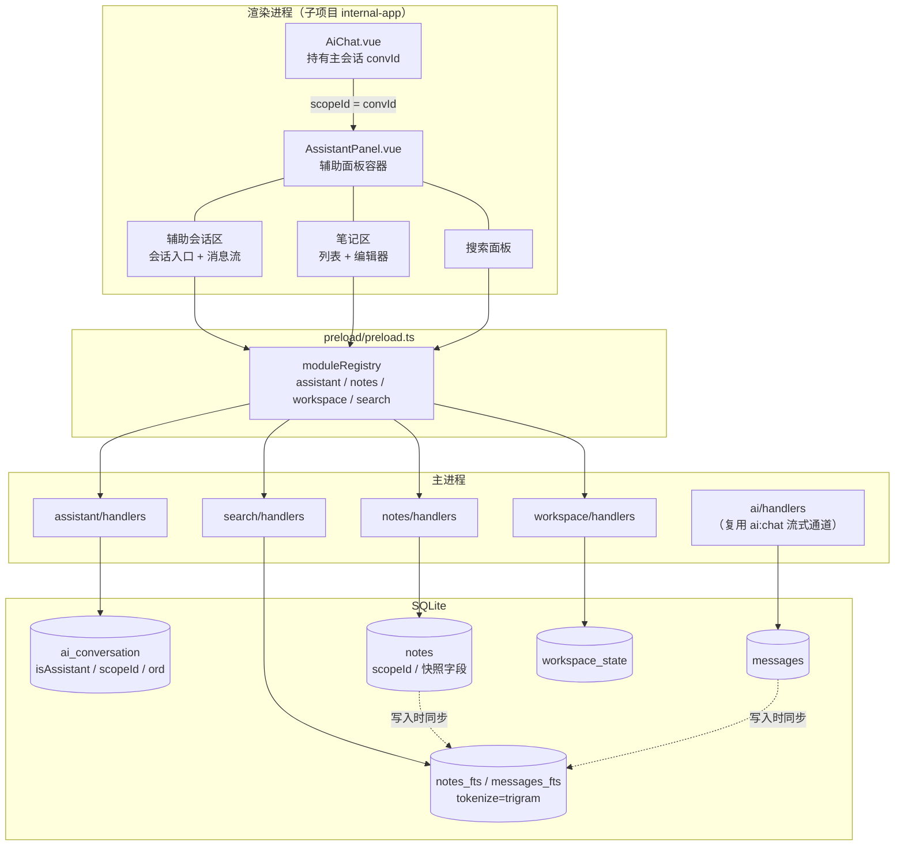
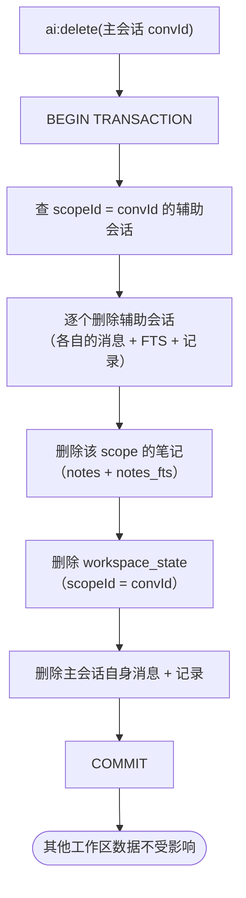
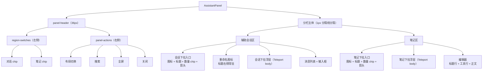

# AI 辅助面板需求文档

> 版本：v2.0 ｜ 状态：已确认 ｜ 最后更新：2026-10-23
>
> v2.0 相对 v1.0 的变更：面板从「独立窗口」改为「主窗口内嵌套侧栏」；Tab 栏不再混排会话与笔记，改为「会话 Tab（上/左）+ 笔记栏（侧/下）」双区；工作区按主会话隔离；新增快照字段、全屏、宽度拖拽、布局切换。

## 1. 背景与目标

在 AI 主会话中，遇到不懂的内容或需要并行探索时，向主会话提问会干扰对主会话的理解；同时 AI 回复中的关键结论容易随对话滚动丢失。

需要一个**辅助面板**，嵌套在主窗口的 AI 聊天页面内，与主聊天区**并排**（默认挤压主区），内含：

- **辅助会话区** — 多个可切换的第二个 AI 会话，与主会话无上下文关联
- **笔记区** — 多个富文本文档，用于记录 AI 会话中的结论和要点

两个区域**同时可见**，互不遮挡。

### 目标

| 目标 | 衡量方式 |
|------|---------|
| 不打断主会话地提问 | 面板内独立 AI 会话，与主会话零耦合 |
| 结论不丢失 | AI 回复可一键摘录为笔记，笔记持久化到磁盘 |
| 多任务并行 | 辅助会话下拉切换 + 多笔记列表 |
| 上下文隔离 | 每个主会话有自己的辅助会话与笔记集合 |
| 找回历史 | 跨全部工作区全文搜索（笔记 + 对话消息） |

### 非目标（本期不做）

- 不做笔记的文件夹/分类/标签体系（扁平结构）
- 不做笔记版本历史
- 不做主会话与辅助会话的上下文传递
- 不做笔记的富文本图片上传（仅支持 URL 引用）
- 不做子区尺寸的独立调整（子区只支持收起/展开，尺寸由内部分隔条控制，见 FR-2.4）

---

## 2. 术语

| 术语 | 含义 |
|------|------|
| **主会话** | `ai_conversation` 表中 `isAssistant = 0` 的记录 |
| **辅助会话** | `ai_conversation` 表中 `isAssistant = 1` 的记录，属于某个工作区 |
| **工作区（scope）** | 一个主会话对应的辅助面板内容集合，由 `scopeId = 主会话 convId` 标识 |
| **笔记** | 富文本文档（HTML），存 `notes` 表，属于某个工作区 |
| **快照字段** | 笔记创建时冗余保存的来源会话标题与来源消息内容，用于来源被删除后仍可读 |

---

## 3. 用户故事

| ID | 作为 | 我想要 | 以便 |
|----|------|--------|------|
| US-1 | 用户 | 在聊天页面顶部点一个按钮，右侧滑出辅助面板 | 不离开当前页面就开始问第二个 AI |
| US-2 | 用户 | 面板里同时开多个 AI 会话，用下拉入口切换 | 并行探索多个方案 |
| US-3 | 用户 | 面板里开多条笔记，列表和编辑器同屏 | 边看旧笔记边写新笔记 |
| US-4 | 用户 | 点 AI 回复上的"记笔记"按钮，自动新建笔记并预填来源快照 | 快速沉淀结论，不打断对话 |
| US-5 | 用户 | 笔记支持加粗、列表、插图 | 笔记可读性好 |
| US-6 | 用户 | 切换主会话时辅助面板自动关闭，下次打开进入该会话自己的工作区 | 不同话题互不串味 |
| US-7 | 用户 | 搜"索引优化"，能找到所有工作区里相关的笔记和对话 | 找回之前讨论过的内容 |
| US-8 | 用户 | 删主会话时知道辅助会话和笔记也会被删 | 有心理预期，不误删 |
| US-9 | 用户 | 拖拽调整面板宽度，或一键全屏 | 按当下需要分配屏幕空间 |

---

## 4. 功能需求

### FR-1 面板形态与尺寸

- FR-1.1 入口按钮位于 AI 聊天页面顶部工具栏（`ChatTopToolbar.vue`），点击切换辅助面板显隐
- FR-1.2 面板为**主窗口内嵌套侧栏**，非独立 BrowserWindow
- FR-1.3 默认**挤压**主聊天区（主区宽度自适应收缩），不覆盖浮层
- FR-1.4 支持**全屏模式**切换：全屏时面板占据主聊天区全部宽度，主区隐藏
- FR-1.5 面板左边缘为**拖拽分隔条**，可调整宽度
  - 默认宽度 560px
  - 最小宽度 400px
  - 最大宽度 = 视口宽度 × 70%
  - 全屏模式下忽略宽度限制
- FR-1.6 面板宽度持久化到 settings（键 `assistant.panelWidth`），重启后恢复
- FR-1.7 关闭面板**不清除任何数据**
- FR-1.8 辅助面板与聊天页右侧的「灵感大全」**互斥**：同一时刻只展开其中一个
  - 打开辅助面板 → 自动收起灵感大全；打开灵感大全 → 自动关闭辅助面板
- FR-1.9 关闭辅助面板被未保存修改拦截时（见 FR-4.6），灵感大全**不展开**，辅助面板保持打开并显示行内确认条

### FR-2 面板内布局

- FR-2.1 面板内含两个区域：**辅助会话区** 与 **笔记区**，同时可见
- FR-2.2 提供布局切换入口（面板标题栏右侧）
  - `左右分栏`：辅助会话在左，笔记在右
  - `上下分栏`：辅助会话在上，笔记在下
- FR-2.3 布局选择持久化到 settings（键 `assistant.panelLayout`）
- FR-2.4 两种布局下，笔记区与辅助会话区之间**均有内部分隔条可拖拽**
  - 辅助会话区占比钳制在 **30% ~ 70%**：笔记区是写作区，太窄就没法用
  - 分隔条常驻一条 1px 分界线，hover 时变强调色（暗色主题下也要能看出分界）
- FR-2.5 笔记区**不提供独立于面板标题栏的折叠按钮**（收起/展开开关统一放在面板标题栏，见 FR-2.6）
- FR-2.6 辅助会话区与笔记区各自支持收起/展开，开关位于**面板标题栏左侧**（两个「区域 chip」，见 §7.2）
  - 两个区可以**同时展开**（分栏视图），所以是独立开关而非互斥的 Tab
  - 收起：该区完全隐藏，不占空间；只剩一个区时内部分隔条一并隐藏，**剩下的区占满面板全部空间**（重新展开时恢复原分栏比例）
  - 两个区都收起 → **整个辅助面板隐藏**（工具栏入口回到未激活状态）
- FR-2.7 面板重新打开时，两个子区都恢复展开；收起状态**不持久化**（重启后默认都展开）

### FR-3 辅助会话

- FR-3.1 辅助会话区顶部为**会话入口**（当前会话标题 + 数量 + 箭头），点击展开**下拉浮层**列出全部辅助会话，可切换
  - 会话列表不常驻占空间；浮层挂在 body 上，不被面板的 overflow 裁掉
- FR-3.2 新建辅助会话时创建 `ai_conversation` 记录，`isAssistant = 1`，并写入当前工作区 `scopeId`
- FR-3.3 辅助会话复用既有 `ai:chat` 流式通道与 AI Profile
- FR-3.4 用户消息和 AI 回复由主进程自动持久化到 `messages` 表
- FR-3.5 会话标题可重命名：**当前会话标题右侧常驻一个重命名图标**，点击弹出改名框，确认后同步到主进程
- FR-3.6 会话顺序可拖拽调整，持久化 —— **当前下拉浮层未提供拖拽入口**（能力在 `useAssistantConversations.reorder`，缺 UI）
- FR-3.7 删除辅助会话需二次确认，级联删除其消息
- FR-3.8 删除辅助会话**不删除**该工作区的笔记（笔记由工作区持有，快照字段保证来源消失后仍可读，见 FR-4.7）

### FR-4 笔记

- FR-4.1 笔记区为「列表下拉 + 编辑器」结构：笔记列表收在下拉浮层里（点击标题行展开），编辑器常驻在下方面板
- FR-4.2 笔记存 `notes` 表，内容为 HTML 富文本，图片通过 URL 引用
- FR-4.3 标题可编辑，默认"新笔记"
- FR-4.4 编辑器工具栏：加粗、斜体、无序列表、有序列表、插入图片 URL
  - 工具栏**分两行**：第一行是笔记标题 + 保存按钮，第二行是格式按钮
  - 笔记区最窄时标题行仍要放得下（保存按钮文字不换行、标题不被压成 0 宽）
- FR-4.5 **手动点击「保存」才落库**，编辑过程中不自动保存
- FR-4.6 切换笔记 / 关闭面板 / 切换主会话时，若当前笔记有未保存修改：
  - 不弹 modal，改为编辑器顶部**行内确认条**：`有未保存的修改 —— 保存 / 放弃 / 取消切换`
  - 默认焦点在「保存」
- FR-4.7 从 AI 回复摘录时，额外记录快照字段 `sourceConvTitle`（来源会话标题）、`sourceMsgContent`（来源消息正文），来源被删除后笔记仍可读
- FR-4.8 手动创建笔记时 `sourceType = 'manual'`
- FR-4.9 笔记内容长度上限 1MB，超限拒绝写入并提示
- FR-4.10 笔记可删除，删除需二次确认

### FR-5 搜索
- FR-5.1 入口：面板标题栏右侧「搜索」图标按钮
- FR-5.2 范围：**全部工作区**（跨主会话），类型为「笔记内容 + 对话消息内容」
- FR-5.3 结果按类型分组（笔记 / 对话），每条显示：所属主会话标题 + 匹配片段（关键词高亮）
- FR-5.4 点击结果：切换到对应主会话 → 打开对应工作区 → 定位到目标笔记/消息并短暂高亮
- FR-5.5 输入防抖 200ms
- FR-5.6 无结果时显示"没有找到匹配内容"

### FR-6 工作区状态

- FR-6.1 每个工作区独立记录：当前激活的辅助会话、当前激活的笔记
- FR-6.2 切换主会话时**关闭辅助面板**；再次打开时加载该主会话的工作区状态
- FR-6.3 首次进入某工作区（无历史状态）时，自动创建一条默认辅助会话并激活

### FR-7 核心流程

> 功能需求是拆散的能力，流程是能力串起来的**端到端路径**。每条流程都必须有对应的测试用例，追溯矩阵见 §10.1。

#### FLOW-1 打开辅助面板并加载工作区
- **触发**：点击聊天页顶部工具栏「辅助面板」按钮
- **步骤**：取当前主会话 `convId` 作为 scopeId → `workspace:getState(scopeId)` → `assistant:list(scopeId)` → `notes:list(scopeId)`
- **结束**：面板显示该工作区的辅助会话（入口行 + 下拉浮层）与笔记列表；激活项取自 state
- **异常**：state 不存在 → 激活项取列表首项；两个列表都为空 → 转 FLOW-11

#### FLOW-2 辅助会话对话
- **触发**：在辅助会话区输入框回车
- **步骤**：`ai:chat`（conversationId = 辅助会话 convId）→ 主进程写入用户消息 → 流式推送 → `streamingChatHandler` 写入 AI 回复
- **结束**：消息区追加用户与 AI 两条消息，均已落库
- **异常**：流中断 → 已落库的部分保留，不回滚

#### FLOW-3 从 AI 回复摘录为笔记
- **触发**：hover AI 消息出现「摘录为笔记」图标按钮
- **步骤**：`notes:create({ scopeId, title, content, sourceType:'ai_message', sourceConvId, sourceMsgId, sourceConvTitle, sourceMsgContent })`
- **结束**：笔记出现在笔记列表并被激活，来源快照已写入
- **异常**：无

#### FLOW-4 编辑并保存笔记
- **触发**：编辑器内修改内容 → 点击「保存」
- **步骤**：本地校验长度 ≤ 1MB → `notes:update(noteId, { title, content })`
- **结束**：DB 更新 + `notes_fts` 同步；保存态复位
- **异常**：超限 → 拒绝写入并提示，**编辑区内容保留**（NFR-R5）

#### FLOW-5 未保存修改的处理
- **触发**：当前笔记有未保存修改时，切换笔记 / 关闭面板 / 切换主会话
- **步骤**：编辑器顶部插入行内确认条（保存 / 放弃 / 取消切换），默认焦点在「保存」
- **结束**：「保存」→ 落库后继续切换；「放弃」→ 丢弃草稿后继续；「取消切换」→ 停留在原笔记
- **异常**：无

#### FLOW-6 切换主会话
- **触发**：点击主会话列表中的另一个会话
- **步骤**：主会话 convId 变化 → 关闭辅助面板（面板关闭时不再加载新工作区）
- **结束**：面板隐藏；再次打开时执行 FLOW-1，显示新工作区的辅助会话与笔记
- **异常**：旧工作区存在未保存笔记 → 先执行 FLOW-5，用户确认后再关闭面板并切换

#### FLOW-7 搜索并跳转
- **触发**：点击面板标题栏「搜索」图标，输入关键词
- **步骤**：防抖 200ms → `search:query(keyword)`
- **结束**：结果按「笔记 / 对话」分组，每条标注来源主会话标题；点击结果 → 切换主会话 → 定位到目标笔记/消息并短暂高亮
- **异常**：关键词 < 3 字符走 `LIKE` 回退；无结果 → 显示空态文案

#### FLOW-8 删除辅助会话
- **触发**：辅助会话的删除入口 → 二次确认
- **步骤**：`assistant:deleteSession(convId)` → 事务内删 messages + `messages_fts` + `ai_conversation` + 置空 `activeConvId`
- **结束**：该会话从列表消失；**该工作区的笔记保留**（FR-3.8）
- **异常**：无

#### FLOW-9 删除主会话（级联）
- **触发**：删除主会话 → 确认框列出「主会话及消息 / 关联辅助会话 N 个 / 笔记 M 条」
- **步骤**：`ai:delete(convId)` → 事务内依次删除：本 scope 的辅助会话（各带消息）→ 本 scope 的笔记（+ FTS）→ `workspace_state` → 主会话自身消息 → 主会话
- **结束**：关联数据全部清除，不留孤儿
- **异常**：无

#### FLOW-10 面板尺寸与布局
- **触发**：拖拽面板左边缘 / 点击全屏 / 点击布局切换
- **步骤**：宽度钳制在 [400px, 视口 70%]；写入 settings 的 `assistant.panelWidth` / `assistant.panelLayout` / `assistant.panelFullscreen`
- **结束**：重启后恢复
- **异常**：视口过窄导致 70% < 400px → 取两者较大值

#### FLOW-11 首次进入工作区
- **触发**：某工作区无任何辅助会话（state 不存在或列表为空）
- **步骤**：`assistant:create(scopeId)` → `workspace:setActive(scopeId, { convId })`
- **结束**：面板显示一个空的新辅助会话
- **异常**：无

#### FLOW-12 收起子区
- **触发**：点击面板标题栏的「辅助会话区」或「笔记区」开关
- **步骤**：翻转该区的收起状态 → 两个区都收起时隐藏整个面板
- **结束**：被收起的区完全隐藏、不占空间；两区都收起时面板整体隐藏（数据不清除，FR-1.7）
- **异常**：笔记有未保存修改时收起笔记区 —— 不弹确认条，草稿保留，重新展开后仍在

#### FLOW-13 切换右侧面板（辅助面板 ↔ 灵感大全）
- **触发**：点击工具栏的「辅助面板」或「灵感大全」入口
- **步骤**：打开辅助面板 → 收起灵感大全；打开灵感大全 → 关闭辅助面板（先过未保存修改守卫）
- **结束**：右侧任意时刻只有一个面板展开
- **异常**：笔记有未保存修改 → 关闭辅助面板被拦截，辅助面板保持打开并出现行内确认条，灵感大全不展开（FR-1.9）

#### 流程图：模块调用链



#### 流程图：级联删除（FLOW-9）



---

## 5. 数据模型

### 5.1 归属关系

```
主会话 (ai_conversation, isAssistant=0, convId = S)
  │  scopeId = S
  ├── 辅助会话 (ai_conversation, isAssistant=1, scopeId=S, ord)
  │     └── messages (按 convId)
  ├── 笔记 (notes, scopeId=S, ord)
  └── 工作区状态 (workspace_state, scopeId=S)  → activeConvId / activeNoteId
```

**关键决策：笔记由工作区（主会话）持有，不由辅助会话持有。**
理由：笔记的价值是"沉淀结论"，它的生命周期应当比产生它的那个辅助会话更长。删除辅助会话不应连带删除用户辛苦写下的结论；快照字段（FR-4.7）保证来源消失后笔记内容依然完整可读。

### 5.2 复用现有表

| 表 | 改动 |
|----|------|
| `ai_conversation` | 新增 `scopeId TEXT`（辅助会话所属工作区，主会话为 NULL）、`ord INTEGER DEFAULT 0`（Tab 顺序） |
| `messages` | 不改结构；新增 FTS 索引 |
| `settings`（既有键值表） | 存放 `assistant.panelWidth` / `assistant.panelLayout` / `assistant.panelFullscreen` |

### 5.3 新增表

```sql
-- 笔记（富文本文档）
CREATE TABLE notes (
  id              TEXT    PRIMARY KEY,
  scopeId         TEXT    NOT NULL,
  title           TEXT    NOT NULL DEFAULT '新笔记',
  content         TEXT    NOT NULL DEFAULT '',
  ord             INTEGER NOT NULL DEFAULT 0,
  sourceType      TEXT,               -- 'ai_message' | 'manual'
  sourceConvId    TEXT,               -- 来源会话（主或辅助）
  sourceMsgId     TEXT,
  sourceConvTitle TEXT,               -- 快照：来源会话标题
  sourceMsgContent TEXT,              -- 快照：来源消息正文
  createdAt       INTEGER NOT NULL,
  updatedAt       INTEGER NOT NULL
);
CREATE INDEX idx_notes_scope ON notes(scopeId);
CREATE INDEX idx_notes_sourceConv ON notes(sourceConvId);

-- 笔记全文索引
CREATE VIRTUAL TABLE notes_fts USING fts5(noteId UNINDEXED, content, tokenize='trigram');

-- 对话消息全文索引
CREATE VIRTUAL TABLE messages_fts USING fts5(msgId UNINDEXED, convId UNINDEXED, content, tokenize='trigram');

-- 工作区状态（每个主会话一行）
CREATE TABLE workspace_state (
  scopeId      TEXT PRIMARY KEY,
  activeConvId TEXT,
  activeNoteId TEXT
);
```

| 字段 | 说明 |
|------|------|
| `notes.ord` | 笔记在笔记列表中的顺序 |
| `notes.scopeId` | 所属工作区（主会话 convId），删除主会话时级联清除 |
| `workspace_state.activeConvId` | 当前激活的辅助会话，可为 NULL |
| `workspace_state.activeNoteId` | 当前激活的笔记，可为 NULL |

**FTS 表设计说明（两条关键决策）**

1. **分词器必须用 `trigram`，不能用默认的 `unicode61`。**
   `unicode61` 把连续的汉字视为**单个 token**，导致搜「索引」「优化」这类中文词**全部 0 命中**（已实测验证）。`trigram` 按 3 字符滑窗切分，对中文子串匹配正确，且 `snippet()` 返回的是**原文片段**而非分词碎片。依赖 SQLite ≥ 3.34 —— 生产用 better-sqlite3 12.8.0（内置 SQLite 3.51.3），测试用 node:sqlite（Node 24），均满足。

2. **采用「FTS 表自带副本 + 业务 ID 作为 UNINDEXED 列」而非 external-content 表。**
   external-content 模式要求每次 INSERT/DELETE 都手动维护 `rowid` 与原表的对应关系（`'delete'` 命令），一旦某条写入路径漏掉同步就会产生索引与主表不一致的幽灵结果。本项目对 notes/messages 的所有写路径都能集中管控，用业务 ID 做 UNINDEXED 列可以直接 `DELETE ... WHERE noteId = ?`，更可控。

**短关键词（< 3 字符）**：trigram 无法匹配 2 字符及以下的查询。1-2 字符的关键词走 `LIKE '%kw%'` 回退查询，命中上限 20 条。

**`assistant_conv_id` 字段废止**：v1.0 曾在 `ai_conversation` 上加 `assistant_conv_id` 表示"主会话关联的辅助会话"，与 v2.0 的"主会话拥有 N 个辅助会话"冲突。v2.0 用 `scopeId` 表达归属，`assistant_conv_id` 不再需要。

---

## 6. IPC 接口

### 6.1 assistant 模块（辅助会话）

| Channel | 参数 | 返回 | 说明 |
|---------|------|------|------|
| `assistant:create` | `scopeId` | `{ convId }` | 在指定工作区新建辅助会话 |
| `assistant:list` | `scopeId` | `ChatSession[]` | 列出该工作区的辅助会话（按 ord 升序） |
| `assistant:getMessages` | `convId` | `Message[]` | 获取消息（按时间升序） |
| `assistant:rename` | `convId, title` | `true` | 重命名 |
| `assistant:deleteSession` | `convId` | `true` | 级联删除会话及其消息 |
| `assistant:reorder` | `scopeId, orderedConvIds[]` | `true` | 持久化会话顺序 |

消息写入不需要独立 channel — `ai:chat` 持久化用户消息，`streamingChatHandler` 持久化 AI 回复。

### 6.2 notes 模块（笔记）

| Channel | 参数 | 返回 | 说明 |
|---------|------|------|------|
| `notes:create` | `{ scopeId, title?, content?, sourceType?, sourceConvId?, sourceMsgId?, sourceConvTitle?, sourceMsgContent? }` | `Note` | 创建笔记 |
| `notes:list` | `scopeId` | `Note[]` | 列出工作区笔记（按 ord 升序） |
| `notes:get` | `noteId` | `Note \| null` | 获取笔记 |
| `notes:update` | `noteId, { title?, content? }` | `Note` | 更新（content 超限报错） |
| `notes:delete` | `noteId` | `true` | 删除（同步清 FTS） |
| `notes:reorder` | `scopeId, orderedNoteIds[]` | `true` | 持久化笔记顺序 |

### 6.3 workspace 模块（面板与工作区状态）

| Channel | 参数 | 返回 | 说明 |
|---------|------|------|------|
| `workspace:getState` | `scopeId` | `{ activeConvId, activeNoteId }` | 读取工作区状态（不存在返回空状态） |
| `workspace:setActive` | `scopeId, { convId?, noteId? }` | `{ activeConvId, activeNoteId }` | 设置激活项 |
| `workspace:deleteState` | `scopeId` | `true` | 删除工作区状态（主会话删除时调用） |

### 6.4 search 模块

| Channel | 参数 | 返回 | 说明 |
|---------|------|------|------|
| `search:query` | `keyword` | `{ notes: NoteHit[], messages: MessageHit[] }` | 跨全部工作区搜索 |

`NoteHit` = `{ noteId, title, scopeId, scopeTitle, snippet }`
`MessageHit` = `{ msgId, convId, convTitle, scopeId, scopeTitle, snippet }`

### 6.5 面板偏好（复用 settings 模块）

| Channel | 参数 | 返回 | 说明 |
|---------|------|------|------|
| `settings:get` | `key` | `string \| null` | 已有通道，读 `assistant.panelWidth` / `assistant.panelLayout` / `assistant.panelFullscreen` |
| `settings:set` | `key, value` | `true` | 已有通道 |

---

## 7. UI 交互规格

### 7.1 整体布局（左右分栏）

```
┌──────────┬─────────────────────────┬────────────────────────────────────┐
│          │  ChatTopToolbar         │ ┌────────────────────────────────┐ │
│  主会话  │  [B] 辅助面板           │ │ (对话)(笔记)  [L][S][F][X]     │ │ ← 标题栏
│  列表    ├─────────────────────────┤ ├─────────────────────┬──────────┤ │
│          │                         │ │ [M] 索引优化方案[P]  │ [N] 笔记  │ │ ← 下拉入口
│          │      主消息区            │ │                (3)[V]│    (2)[V]│ │ ← 数量 + 箭头
│          │      （被挤压）          │ ├─────────────────────┼──────────┤ │
│          │                         │ │                     │ 笔记标题 │ │
│          │                         │ │   辅助会话消息       │ ──────── │ │
│          │                         │ │                     │ B I • 1. │ │ ← 工具行
│          │  [输入框]                │ │   [输入框]          │ 编辑器   │ │
│          │                         │ │                     │ [保存]   │ │
│          │                         │ └─────────────────────┴──────────┘ │
└──────────┴─────────────────────────┴────────────────────────────────────┘
                                       ↑ 拖拽分隔条（面板左边缘）
```

> 图标均为 lucide 图标，非 emoji。上图用字母做占位：
> `[B]` 机器人（辅助面板入口）· `[M]` 对话气泡 · `[N]` 便签 · `[L]` 布局切换 · `[S]` 搜索 · `[F]` 全屏 · `[X]` 关闭 · `[P]` 铅笔（重命名）· `[V]` 展开箭头



### 7.2 面板容器

| 元素 | 行为 |
|------|------|
| 打开/关闭 | 隐藏面板（`v-if`），不清数据 |
| 主会话切换 | 自动关闭面板；笔记有未保存修改时先走行内确认条 |
| 与灵感大全互斥 | 打开辅助面板自动收起灵感大全；打开灵感大全自动关闭辅助面板（未保存修改被拦截时灵感不展开） |
| 区域开关 | 标题栏**左侧**两个「区域 chip」（对话 / 笔记），分别收起/展开对应子区；两个区可同时展开，故为独立开关而非互斥 Tab；两个都收起时整个面板隐藏 |
| 面板级操作 | 标题栏**右侧**四个图标按钮：布局切换 / 搜索 / 全屏 / 关闭（不重复显示标题文字） |
| 宽度 | 拖拽左边缘调整，范围 [400px, 70% 视口]，持久化到 settings |
| 全屏按钮 | 切换全屏；全屏时主聊天区隐藏，面板占满 |
| 布局按钮 | 切换左右/上下分栏，持久化 |
| 分隔条 | 常驻一条 1px 分界线（hover 变强调色），让两个区的边界可见 |

### 7.3 辅助会话区

| 元素 | 行为 |
|------|------|
| 会话下拉入口 | 标题行显示图标 + 当前会话标题 + 会话数量 chip + 展开箭头；点击展开下拉浮层列出全部会话 |
| 标题右侧的重命名图标 | 常驻可见（弱化为 tertiary 色，hover 强调），点击弹出改名框；改名框复用主聊天的 `ChatHeaderRename`，带非法字符 / 长度校验 |
| 下拉内的会话项 | 显示标题；点击切换激活（当前项高亮） |
| 会话项上的删除图标 | 删除辅助会话（二次确认，级联删除其消息；**该工作区的笔记保留**，见 FR-3.8） |
| 会话项拖拽排序 | 🔸 能力已在 `useAssistantConversations.reorder`，**当前下拉浮层未提供排序入口**（待产品确认交互形式） |
| `+` 按钮 | 新建辅助会话 |
| 消息列表 | 用户右侧、AI 左侧 bubble 布局 |
| AI 消息「摘录为笔记」按钮 | hover 显示；点击 → 在当前工作区新建笔记并预填来源快照 |
| 已选中文字时 | 按钮旁浮出"保存选中部分" |
| 输入框 | Enter 发送，Shift+Enter 换行 |
| 空状态 | Bot 图标 + "向第二个 AI 提问" |
| 流式输出 | 仅当用户处于底部时才 auto-scroll（距底 < 100px） |

### 7.4 笔记区

| 元素 | 行为 |
|------|------|
| 笔记下拉入口 | 标题行显示图标 + "笔记" + 数量 chip + 展开箭头；点击展开下拉浮层列出全部笔记 |
| 下拉内的笔记项 | 显示标题 + 更新时间；点击切换编辑目标；当前项高亮 |
| 笔记项上的删除 | 删除笔记（二次确认） |
| 笔记标题 | 行内 input，与工具行分离（笔记区可能只有 240px 宽，同一行放不下标题+工具+保存） |
| 编辑区 | `contenteditable` div |
| 工具行 | B / I / 无序列表 / 有序列表 / 插入图片 URL（独立一行，不与标题争宽度） |
| 保存按钮 | 写入数据库，同时同步 FTS 索引；标题行右侧，`white-space: nowrap` 不换行 |
| 未保存确认条 | 切换笔记/关闭面板/切换主会话时，顶部插入行内条 |

### 7.5 搜索面板

```
┌──────────────────────────────────────────────┐
│ [S] [搜索笔记和对话内容...]             [X]  │
├──────────────────────────────────────────────┤
│ [N] 笔记 (2)                                 │
│ ┌──────────────────────────────────────────┐ │
│ │ 关于索引优化的结论      · 主会话「性能」  │ │ ← 标注来源主会话
│ │ ...这次聊到了**索引**优化的问题...       │ │
│ └──────────────────────────────────────────┘ │
│ [M] 对话 (3)                                 │
│ ┌──────────────────────────────────────────┐ │
│ │ 辅助会话A                  · 主会话「性能」│ │
│ │ ...提到了**索引**的选择...               │ │
│ └──────────────────────────────────────────┘ │
└──────────────────────────────────────────────┘
```

> 图标占位同 §7.1：`[S]` 搜索 · `[X]` 关闭 · `[N]` 便签 · `[M]` 对话气泡

| 情况 | 表现 |
|------|------|
| 搜索词为空 | 面板收起 |
| 无匹配 | "没有找到匹配内容" |
| 搜索中 | 加载态 |

---

## 8. 非功能需求

### 8.1 可靠性

| 编号 | 需求 |
|------|------|
| NFR-R1 | 所有多表写操作（删除会话 + 删消息 + 删笔记 + 删状态）在单个事务内完成 |
| NFR-R2 | 删除操作**手动按序删除**，不依赖数据库外键自动级联（显式优于隐式，便于审计） |
| NFR-R3 | 写入后主动同步 FTS 索引，避免索引与主表不一致 |
| NFR-R4 | 删除会话、关闭面板、切换主会话均不触发任何数据删除 |
| NFR-R5 | 笔记保存失败（超限/DB 错误）时保留编辑区内容，不清空草稿 |

### 8.2 数据完整性（孤儿数据）

| 场景 | 处理 |
|------|------|
| 删除主会话 | 事务内依次删除：该工作区的笔记 → 各辅助会话的消息 → 各辅助会话 → 工作区状态 → 主会话自身消息 → 主会话 |
| 删除辅助会话 | 事务内删除：该会话的消息 → 该会话；**保留**该工作区的笔记（快照保证可读） |
| 删除笔记 | 删除 notes + FTS 记录 |
| 删除工作区状态 | 主会话删除时一并清除 |

**不产生孤儿**：任何会话/笔记被删除时，指向它的 `workspace_state.activeConvId` / `activeNoteId` 同步置空。

### 8.3 安全性

| 编号 | 需求 |
|------|------|
| NFR-S1 | 所有 SQL 使用参数化查询，禁止字符串拼接 |
| NFR-S2 | 笔记 content 渲染前过滤 `<script>` / `on*` 事件属性 / `javascript:` URL |
| NFR-S3 | 笔记 content 长度上限 1MB，超限拒绝写入并报错 |
| NFR-S4 | 会话/笔记 ID 格式校验（拒绝非预期字符） |
| NFR-S5 | 搜索关键词经引号转义后作为 FTS5 查询参数传入；FTS5 查询语法错误需捕获并降级为 LIKE 字面匹配 |

### 8.4 性能

| 编号 | 需求 |
|------|------|
| NFR-P1 | 搜索走 FTS5 trigram 虚拟表，不扫描主表；关键词 < 3 字符时走 `LIKE` 回退（上限 20 条） |
| NFR-P2 | 搜索输入防抖 200ms |
| NFR-P3 | 笔记操作走独立 IPC channel，不阻塞 AI 流式推送 |
| NFR-P4 | 消息列表按时间倒序分页加载，首屏最近 20 条 |

---

## 9. 实施计划

分步交付，每步可独立验证。

| Step | 范围 | 验收 |
|------|------|------|
| 1 | 数据层：notes / workspace_state / scopeId / FTS 表 | 表结构与 DAO 单测通过 |
| 2 | IPC：assistant / notes / workspace / search 四个模块 | IPC handler 单测通过 |
| 3 | 主进程注册（bootstrap + preload moduleRegistry） | 渲染进程能取到模块 |
| 4 | 子项目：面板容器（挤压 / 拖拽宽度 / 全屏 / 布局切换） | 面板能打开、能调宽、能全屏 |
| 5 | 子项目：辅助会话区（会话入口 / 流式聊天 / 摘录） | 能与第二个 AI 对话 |
| 6 | 子项目：笔记区（列表 / 富文本编辑器 / 手动保存 / 未保存确认） | 能写笔记并保存 |
| 7 | 子项目：搜索面板（跨工作区） | 能搜到历史笔记和消息 |

---

## 10. 验收标准

### 10.1 流程 → 测试用例追溯矩阵

这张表是「需求梳理是否正确」的验证工具：**每条流程都要有用例，用例的期望结果必须写死**。有流程没用例 = 未覆盖的路径；有��例没流程 = 噪音。

测试文件：
- `test/assistant/assistantDb.test.ts` — 数据层（DAO）
- `test/assistant/assistantIpc.test.ts` — IPC 层（handler 契约）

| 流程 | AC | 测试文件 | 用例描述 | 期望结果 |
|------|----|---------|---------|---------|
| FLOW-1 | AC-2 | assistantIpc | `assistant:list(scopeId)` 只返回该工作区的辅助会话 | 结果不含其他工作区的会话 |
| FLOW-1 | AC-11 | assistantIpc | `notes:list(scopeId)` 只返回该工作区的笔记 | 结果不含其他工作区的笔记 |
| FLOW-1 | AC-10 | assistantIpc | `workspace:getState` 对未初始化工作区返回空状态 | `activeConvId`/`activeNoteId` 均为 null |
| FLOW-1 | AC-10 | assistantDb | `setWorkspaceActive` 写入激活项后可读回 | 状态表对应行被更新 |
| FLOW-1 | AC-3 | assistantDb | `getMessagesByConvId` 按时间升序返回 | 顺序与写入顺序一致 |
| FLOW-2 | AC-12 | assistantDb | `appendMessage` 后 `messages_fts` 能搜到该消息 | `searchMessages` 命中该 msgId |
| FLOW-3 | AC-1 | assistantDb | `createNote` 的 `scopeId` 正确落库 | `notes.scopeId` 等于传入值 |
| FLOW-3 | — | assistantIpc | `notes:create` 携带快照字段时快照被持久化 | 返回的 Note 含 `sourceConvTitle`/`sourceMsgContent` |
| FLOW-4 | AC-7 | assistantIpc | `notes:update` 更新标题与正文 | 返回 Note 内容为新值 |
| FLOW-4 | AC-9 | assistantIpc | `notes:update` 内容超 1MB 时抛错且不落库 | 抛异常，原内容保持不变 |
| FLOW-4 | AC-8 | assistantDb | 更新笔记后 FTS 命中新内容、旧内容不再命中 | 旧词 0 命中，新词 1 命中 |
| FLOW-5 | AC-22 | 人工 | 有未保存修改时切换笔记出现行内确认条 | 出现行内条，不弹 modal |
| FLOW-6 | AC-6 | assistantIpc | 两个工作区的数据互不干扰 | 切换 scope 后各自只看到自己的数据 |
| FLOW-6 | AC-19 | app/test/AiChatSwitchSession.test.ts | 左侧切换主会话时辅助面板关闭 | 面板隐藏且主会话已切换；笔记有未保存修改时先出现行内确认条 |
| FLOW-7 | AC-11 | assistantIpc | `search:query` 跨工作区同时命中笔记与消息 | `notes` 与 `messages` 均返回结果 |
| FLOW-7 | AC-11 | assistantDb | 搜索结果标注来源主会话标题 | `scopeTitle` 等于主会话标题 |
| FLOW-7 | AC-27 | assistantDb | 中文关键词命中，snippet 为原文片段 | snippet 含完整中文词而非分词碎片 |
| FLOW-7 | AC-28 | assistantDb | 1-2 字符关键词走 LIKE 回退 | 仍能命中内容 |
| FLOW-7 | AC-23 | 人工 | 点击搜索结果跳转并高亮 | 切换主会话并定位到目标 |
| FLOW-8 | AC-4 | assistantIpc | 删除辅助会话清空其消息 | `messages` 计数为 0 |
| FLOW-8 | AC-4 | assistantIpc | 删除辅助会话后该工作区的笔记**保留** | `notes` 记录仍存在 |
| FLOW-8 | AC-4 | assistantDb | 删除辅助会话后 `messages_fts` 同步清除 | 搜索不再命中该消息 |
| FLOW-8 | AC-10 | assistantIpc | 删除辅助会话后 `activeConvId` 被置空 | `activeConvId` 为 null |
| FLOW-9 | AC-5 | assistantIpc | 删除主会话清空其辅助会话与消息 | 两者均不存在 |
| FLOW-9 | AC-5 | assistantIpc | 删除主会话清空其工作区的笔记 | `notes` 计数为 0 |
| FLOW-9 | AC-5 | assistantIpc | 删除主会话清空 `workspace_state` | 该 scope 无状态行 |
| FLOW-9 | AC-6 | assistantIpc | 删除主会话不影响其他工作区 | 其他 scope 的笔记与会话仍在 |
| FLOW-9 | AC-6 | assistantDb | 删除主会话后其 FTS 记录同步清除 | 搜索不再命中 |
| FLOW-9 | AC-24 | 人工 | 删除确认框列出将删除的关联内容 | 明确列出辅助会话数与笔记数 |
| FLOW-10 | AC-15~17 | 人工 | 拖拽宽度 / 全屏 / 布局切换并持久化 | 重启后恢复 |
| FLOW-11 | — | assistantIpc | 空工作区创建辅助会话并激活 | `list` 长度为 1 且 `activeConvId` 等于新建 convId |
| FLOW-12 | AC-29 | app/test/AssistantPanel.test.ts | 收起单个子区 / 两个都收起时面板隐藏 / 重开都展开 | 被收起的区隐藏；都收起时面板隐藏；重开后两区都展开 |
| FLOW-13 | AC-30 | app/test/AiChatRightPanels.test.ts | 打开辅助面板 / 打开灵感大全 / 有未保存修改时点灵感大全 | 右侧始终只有一个面板展开；被未保存修改拦截时灵感不展开 |
| 安全 | AC-13 | assistantIpc | 恶意 scopeId / 关键词参数化查询，不破坏表结构 | 表仍存在且数据未被篡改 |
| 安全 | AC-13 | assistantIpc | 含引号等 FTS 特殊字符的关键词不抛错 | 正常返回结果（空或部分命中） |

### 10.2 数据层（自动化测试覆盖）

| ID | 验收点 |
|----|--------|
| AC-1 | 创建辅助会话后，`ai_conversation` 中存在 `isAssistant = 1` 且 `scopeId` 指向当前工作区的记录 |
| AC-2 | `assistant:list(scopeId)` 只返回该工作区的辅助会话，按 `ord` 升序 |
| AC-3 | 辅助会话消息按时间升序返回 |
| AC-4 | 删除辅助会话后其消息被清除；**该工作区的笔记保留**且快照字段可读 |
| AC-5 | 删除主会话时，其工作区的辅助会话、消息、笔记、工作区状态一并清除 |
| AC-6 | 删除主会话**不影响**其他工作区的笔记与辅助会话 |
| AC-7 | 笔记可创建、更新、删除；删除后 FTS 索引同步清除 |
| AC-8 | 笔记保存后 FTS 搜索命中，返回正确的 snippet 与所属主会话标题 |
| AC-9 | 超过 1MB 的笔记内容被拒绝写入 |
| AC-10 | 工作区状态可读写；激活项指向已删除对象时自动置空 |
| AC-11 | 搜索跨全部工作区，结果标注来源主会话标题 |
| AC-12 | 消息写入后同步 FTS，搜索能命中对话消息 |
| AC-13 | 所有 SQL 为参数化查询（注入测试通过） |
| AC-27 | 中文关键词（如「索引优化」）能正确命中笔记与消息，返回的 snippet 是原文片段而非分词碎片 |
| AC-28 | 1-2 字符的短关键词走 LIKE 回退，仍能命中内容 |

### 10.3 UI 层（人工验证）

| ID | 验收点 |
|----|--------|
| AC-14 | 点击顶部工具栏按钮，右侧滑出面板并挤压主聊天区 |
| AC-15 | 拖拽面板左边缘，宽度在 [400px, 70% 视口] 内变化，重启后恢复 |
| AC-16 | 全屏切换生效，主聊天区隐藏 |
| AC-17 | 布局可在左右/上下之间切换，重启后恢复 |
| AC-18 | 辅助会话可新建、切换、删除（拖拽排序与重命名当前无 UI 入口，见 FR-3.5 / FR-3.6） |
| AC-19 | 切换主会话，辅助面板关闭；重新打开后显示新工作区的会话与笔记 |
| AC-20 | AI 回复 hover 出现「摘录为笔记」图标，点击生成带快照的笔记 |
| AC-21 | 笔记支持加粗/列表/图片 URL，手动保存后重新打开内容完整 |
| AC-22 | 有未保存修改时切换笔记，出现行内确认条而非弹窗 |
| AC-23 | 搜索能命中其他工作区的笔记和对话，点击结果跳转并高亮 |
| AC-24 | 删除主会话时确认框明确列出将被删除的关联内容 |
| AC-29 | 辅助会话区与笔记区都能单独收起；都收起时整个辅助面板隐藏；重新打开后都展开 |
| AC-30 | 辅助面板与灵感大全互斥：打开一个，另一个自动收起；笔记有未保存修改时灵感大全不展开 |
