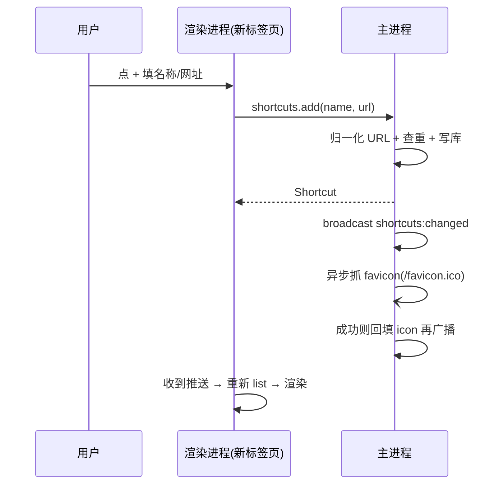

# 自定义快捷方式（shortcuts 模块）

> 新标签页里用户手动创建的快捷入口。**与收藏夹（favorites）是两个概念**：
> 收藏夹是浏览时顺手收藏的页面，快捷方式是主动建的常用入口，互不混用。

## 目的

让用户在新标签页一键打开常用站点 —— 不必先打开该站点、再收藏、再去收藏夹找。

## 接口

主进程模块 `electron/modules/shortcuts/`，IPC channel：

| channel | 入参 | 返回 | 说明 |
|---------|------|------|------|
| `shortcuts:list` | — | `Shortcut[]` | 按 `createdAt ASC`（创建顺序）返回全部 |
| `shortcuts:add` | `{ name?, url }` | `Shortcut` | 校验失败抛错，重复 url 抛「该快捷方式已存在」 |
| `shortcuts:remove` | `id` | `boolean` | id 非法或不存在返回 false |
| `shortcuts:changed` | — | `Shortcut[]` | 主进程广播（全窗口 + 全标签页子应用 + popup） |

`Shortcut` 结构：

```ts
interface Shortcut {
  id: string        // short-<uuid>
  name: string      // 为空时用 hostname 兜底
  url: string       // 归一化后的 http/https 网址
  icon: string | null  // data:image/*;base64，抓取失败为 null
  createdAt: number
  updatedAt: number
}
```

数据库表 `shortcuts`（`id` 主键，`url` 唯一约束）。

子应用侧通过 `window.bridge.getModules(['shortcuts']).shortcuts` 调用，
变更推送订阅 `window.bridge.channels.shortcuts.changed`。

## 关键流程

### 添加



- **添加不等待图标**：`add` 立刻返回，favicon 是网络请求，卡住它等于卡住用户
- 图标到位后二次广播，渲染层把首字母色块换成图片

### 删除

hover 出现 `×` → 二次确认 → `shortcuts:remove(id)` → 主进程删库并广播 → 渲染层刷新。

### 图标

1. 查 `page_icons` 表缓存（与"访问过的页面"共用同一张表）
2. 未命中 → 探测 `${origin}/favicon.ico`
3. 失败 → `icon` 保持 null，渲染层回退到**首字母色块**（色相由 url hash 决定，同站点颜色稳定）

## 假设

- 快捷方式只指向 `http/https` 站点，不支持内部路由（`lsqapp://`）
- 名称 ≤ 32 字符，网址 ≤ 2048 字符
- 归一化会去掉根路径末尾斜杠 —— 让 `example.com` 与 `https://example.com/` 视为同一个

### 校验规则

主进程是权威（`electron/modules/shortcuts/manager/index.ts`），渲染进程只做前置粗筛。

**网址**（`normalizeShortcutUrl`）：

| 规则 | 拒绝示例 | 报错 |
|------|----------|------|
| 非空 | `''` | 网址不能为空 |
| ≤ 2048 字符 | 超长 | 网址不能超过 2048 个字符 |
| 仅 http/https | `file://`、`ftp://` | 仅支持 http/https 网址 |
| 协议可解析 | `https://` | 网址格式不合法 |
| hostname 像域名 | `abc`、`example`、`example..com` | 网址格式不合法：域名看起来不像网址，请检查是否漏了后缀 |

hostname 判定（`isValidHostname`）：IPv6（`[...]`）、IPv4（四段且每段 ≤ 255）、`localhost`，
其余必须含点、每段非空且 ≤ 63 字符、只含 `a-z0-9-`，总长 ≤ 253。

> `new URL` 对 `abc` / `example..com` 是解析成功的，但浏览器拿到 `https://abc` 只会当搜索词 ——
> 所以按 DNS 规范再卡一道。

**名称**（`resolveShortcutName`）：为空时用 hostname 兜底（去掉 `www.` 前缀）；≤ 32 字符；不含控制字符
（含换行、制表符，会破坏界面排版）。

**渲染进程前置粗筛**（`ShortcutDialog.vue` 的 `looksLikeUrl`）：host 不含点、不是 `localhost`、
不是 IP 时直接拦下，省掉一次 IPC 往返。粗筛放过的（如 `example..com`）由主进程兜住。

## 依赖

- `electron/shared/broadcast.ts` —— 广播到所有窗口 / 标签页子应用 / popup
- `electron/modules/icons/` —— favicon 抓取与 `page_icons` 缓存
- 子应用 `src/views/NewTabPage.vue` + `src/components/common/ShortcutDialog.vue`

## 已知限制

- favicon 只探测 `/favicon.ico`，不解析 HTML 里的 `<link rel="icon">` —— 少数站点拿不到图标（回退色块）
- 不支持编辑（改名/换图标）、不支持拖拽排序（顺序 = 创建顺序）
- 新标签页里的预置 4 个站点（B站/知乎/小红书/抖音）仍是子应用里写死的常量，不入库、不可删
- 不做级联删除：快捷方式不被其他表引用；`page_icons` 里的图标缓存与快捷方式生命周期解耦，删除后保留
- 不接受带协议以外前缀的输入（`javascript:`、`data:` 等）—— 只允许 http/https
